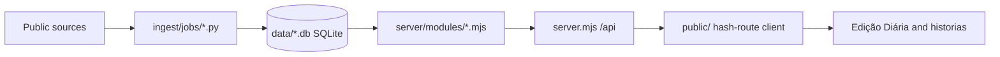

# Estado Aberto

Um diário aberto da democracia portuguesa: decisões, votações, leis, relatórios, auditorias, nomeações e discursos, ligados entre si e às entidades que os produzem. O dinheiro público é uma secção, não o centro.

Estado Aberto is a Portuguese open-data portal. It collects what public bodies publish, links it by entity (NIF, name, legislature) and presents it as a daily edition, scrollytelling stories and browsable sections. The interface is in Portuguese.

## Who it is for

- Citizens and journalists who want to follow who decided what, how each party voted and what was audited.
- Researchers who need linked, sourced public records.
- Contributors who want to add a public data source and a page that answers a concrete question about decisions.

## What is in it

| Section | Examples |
|---|---|
| Parlamento | calendário, leis em curso e o seu percurso, votações por partido, posições, deputados, intervenções |
| Governo | Governo, ministérios, quem decide, Presidência, Estado e empresas |
| Dinheiro público | contratos públicos, Orçamento do Estado, apoios, concursos e anúncios, fundos, dívida |
| Poder local | municípios e freguesias, contas das câmaras, regiões autónomas, empresas locais, eleições |
| Instituições | diretório de entidades, reguladores, educação, saúde, segurança |
| Leis e justiça | Diário da República, tribunais e Tribunal Constitucional, Provedor de Justiça, atos do Presidente |
| Indicadores | séries do INE, habitação, imigração, educação (DGEEC) |
| Roadmap | what is being built, what is next, what is done |

The home page is the Edição Diária. Stories live in `public/historias/` (see `docs/HISTORIAS.md` and `docs/STORY_ENGINE.md`).

## Data policy

No real data is ever committed, attached to a pull request or release, or uploaded to any server. The repository ships only code, schemas, synthetic sample generators and documentation. Anyone who needs data runs the ingest tools against the public sources. See `docs/DATA_POLICY.md`.

## Quickstart: synthetic demo

Requires Node 22.5 or newer and Python 3.10 or newer. Nothing to install.

```sh
git clone https://github.com/Mais-Democracia/Estado-Aberto.git
cd Estado-Aberto
python3 tools/make_sample.py
npm start
```

Open http://localhost:3000. The sample is synthetic and labelled as such on screen; it exercises the interface and informs no one.

## Real data

```sh
python3 tools/bootstrap.py
python3 ingest/run_all.py
```

Honest expectations: a full first build downloads several GB (public contracts alone are about 2 million rows), takes several hours because sources are polled politely, and needs about 10 GB of free disk. Peak memory stays below 1 GB because jobs stream and run one after another. Run a single job with `python3 ingest/run_all.py <name>`. Data lands in `data/`, which is gitignored. Per-source size and time are in `docs/SOURCES.md`.

## Architecture



Details, including the resource budget (the production box has 1 GB RAM), are in `docs/ARCHITECTURE.md`.

## Contributing

Read `CONTRIBUTING.md`. Coding agents follow `AGENTS.md`. To add a data module run `python3 tools/new_module.py <name> --section <section>` and follow `docs/MODULES.md`. For ideas, open an issue from the templates; see `docs/ROADMAP_PROCESS.md`.

## Roadmap

`docs/ROADMAP.md` (in progress and done) and `docs/BACKLOG.md` (open items).

## Licence

Code: MIT, see `LICENSE`. Data is not distributed; each source keeps its own terms, see `DATA-LICENSE.md` and `docs/SOURCES.md`.
