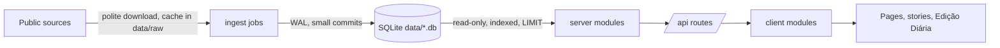

# Architecture

## Components

| Component | Where | Role |
|---|---|---|
| Ingest jobs | `ingest/jobs/*.py`, manifest `ingest/jobs.json`, runner `ingest/run_all.py` | Python 3 stdlib. Download public sources politely, write one SQLite file per domain in `data/` |
| Databases | `data/*.db` (gitignored) | `politica.db` holds the shared entity registry, contracts and agenda; each module owns `data/<name>.db` |
| Server | `server.mjs` | Dependency-free Node 22. Static files, route table, read-only SQLite via `node:sqlite` |
| Server modules | `server/modules/*.mjs` | Register `/api/<name>/...` routes; open `data/<name>.db` read-only |
| Client | `public/` | Vanilla JS, hash routes (`#/<page>`), `Portal.page`, `Portal.nav`, `Portal.NAV_GROUPS` |
| Client modules | `public/modules/*.js` | One page per domain, loaded from `/api/modules` |
| Stories | `public/historias/` | Scrollytelling stories on a shared engine, see `docs/STORY_ENGINE.md` and `docs/HISTORIAS.md` |
| Edição Diária | home page, `server/modules/edicao.mjs` | The daily edition: what changed today across the sections |

## Data flow

Every row carries a `source_url`, and entities are joined across modules by NIF (or by name when there is none), so a person, a body, a law and a contract can be followed from page to page.

## Sections

Parlamento, Governo, Dinheiro público, Poder local, Instituições, Leis e justiça, Indicadores, plus the Roadmap page. The menu is `Portal.NAV_GROUPS` in `public/portal.js`; each group also has a story at `#/historia/<slug>`.

## Story engine

Stories are declarative scenes bound to API data or fixtures; the engine handles scrolling, step transitions and charts. Figures in a scene always come from a route or fixture, never from hand-typed numbers. See `docs/STORY_ENGINE.md`.

## The Edição Diária

The home page assembles the day's changes (new laws and votes, decisions, reports, appointments, speeches) from module routes, and links each item to its source. `daily.sh` refreshes the light jobs; `update.sh` rebuilds the heavy ones.

## Resource budget

Production runs on a small AWS Lightsail instance: 1 GB RAM, 2 vCPU, 40 GB SSD. This is a design constraint, not a detail.

- Lean memory: no whole-table loads into JS or Python; indexed SQL does the work.
- Streaming ingest: read large JSON/CSV/XML incrementally, never a multi-GB file in memory.
- Sequential jobs: `ingest/run_all.py` runs one job at a time; a job must not spawn parallel heavy workers.
- No heavy dependencies: Node built-ins and Python stdlib only.
- Bounded responses: every query has a `LIMIT`; lists are paginated; no endpoint streams a whole table.
- Readers never block: jobs use WAL and short transactions so the live site stays responsive during ingest.
- Disk: raw downloads are cached under `data/raw/` and can be pruned; databases are rebuildable.

A new module states its expected size, time and peak RAM in `docs/SOURCES.md`.

## Server-side AI digest

Approved by the repository owner on 2026-11-06: AI-written articles are published automatically, without per-article human approval, only when every safety gate passes. Code lives in `ops/ai/`, documented in `docs/AI_DIGEST.md`.

- A staged pipeline (bundle, triage, selection, drafting, code verification, review) writes approved article files to `state/ai/published/<date>/`; `ingest/jobs/diario_ia.py` imports them into `diario.db` as the app user.
- Publish gate: the code verifier passes (every number, date and name is in the evidence, hrefs are allowed, at most 250 words), the reviewer says ok and confidence is at least 0.7. Anything else is kept as rejected for audit and the event stays in the plain list.
- The AI job runs as its own user with read-only data and write access only to `state/ai`, inside a systemd sandbox with a memory cap and runtime cap, and never ships data or reaches deploy credentials, release tooling or any production database for writing.
- Hard budgets (daily, monthly, articles per day), an audit log and two kill switches (`AI_ENABLED=0`, the `STOP` file). It is disabled until the owner enables it.
- Articles are labelled as machine-written and carry sources; honesty rules still apply: sourced, no invented numbers.
